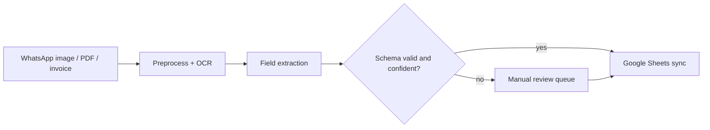
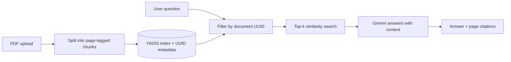

<!--
  GitHub profile README. Save it as README.md in a PUBLIC repo named exactly like your username:
  github.com/ritikchauhan2068/ritikchauhan2068

  Files that go with it (same repo):
    assets/header.svg                 animated banner (self-hosted, no third-party service)
    assets/streak.svg                 built by .github/workflows/streak.yml (your existing workflow)
    .github/workflows/snake.yml       builds the contribution snake onto the "output" branch

  Search for "REPLACE" before publishing: those links need your real repo URLs.
-->

 

*I build production AI systems and automation workflows that save small businesses hours of manual work every day.*

 

---

## 📊 Impact at a glance

<table>
  <tr>
    <td align="center" width="20%"><h2>2</h2>live client deployments</td>
    <td align="center" width="20%"><h2>90%+</h2>OCR field extraction accuracy</td>
    <td align="center" width="20%"><h2>2+ hrs</h2>manual entry saved(Testing) every day</td>
    <td align="center" width="20%"><h2>10,000+</h2>real-estate listings in the recommender</td>
    <td align="center" width="20%"><h2>18%</h2>relevance lift over keyword baseline</td>
  </tr>
</table>

---

## 🧭 What I do

| | |
|---|---|
| 🤖 **LLM & RAG applications** | Document-grounded assistants with source citations, built on LangChain, FAISS, and Gemini |
| 📄 **OCR & document intelligence** | Turning WhatsApp images, invoices, and PDFs into validated, structured data |
| ⚙️ **Backend & automation** | FastAPI services, Google Sheets / n8n workflows, and Docker deployments on DigitalOcean and Render |

Since early 2025 I've been shipping backends for real clients.

---

## 🚀 Featured projects

### 📦 OCR-Powered Order Automation
Extracts structured order data from WhatsApp images, invoices, receipts, and PDFs, validates it against a schema, and syncs it to Google Sheets.

- ✅ **90%+** field extraction accuracy &nbsp;·&nbsp; ⏱️ saves **2+ hours** of manual entry every day
- Low-confidence records go to a review queue instead of the spreadsheet

`Python` `FastAPI` `Tesseract OCR` `LangChain` `Google Sheets API` `Docker`

🔗 [Repository](https://github.com/ritikchauhan2068/OCR-For-Business)

<b>🔍 How it works</b>

---

### 📚 DocuMind: Document-Grounded RAG Assistant
Ask questions about multi-page PDFs and get answers with **page-level citations**. Document isolation through UUID metadata filtering stops answers from leaking across files.

- FAISS similarity search with multi-turn conversational context
- Built for transparency: every answer points back to its source page

`Python` `FastAPI` `LangChain` `FAISS` `Google Gemini`

🔗 [Repository](https://github.com/ritikchauhan2068/REPLACE-WITH-DOCUMIND-REPO)

<b>🔍 How it works</b>

---

### 🏠 Property Recommendation Engine
Content-based recommender over **10,000+ scraped real-estate listings**, using engineered features (price per sq ft, locality tiers, amenity scores) and TF-IDF with cosine similarity.

- 📈 **18%** relevance lift over a keyword-search baseline
- Served through a low-latency API

`Python` `Scikit-learn` `BeautifulSoup` `NLP` `FastAPI`

🔗 [Repository](https://github.com/ritikchauhan2068/Flat-recommdation-system)

---

### 🌐 Client work in production

| Client | What I delivered | Live |
|---|---|---|
| **Heritage Almora** (hospitality) | Backend, cloud deployment, SEO, Google Business optimisation | [heritagealmora.com](https://www.heritagealmora.com) |
| **Auyrco Pharma** (Ayurvedic pharma) | Backend APIs, performance tuning, deployment automation, business workflow automation | [Live site](https://auyrcopharma-5.onrender.com) |

---

## 🛠️ Tech stack

**AI / ML** 

**Backend** 

**Automation** 

**DevOps & cloud** 

---

## 📈 GitHub activity

<!-- Snake: built daily by .github/workflows/snake.yml and served from the "output" branch -->
<picture>
  <source media="(prefers-color-scheme: dark)" srcset="https://raw.githubusercontent.com/ritikchauhan2068/ritikchauhan2068/output/github-snake-dark.svg" />
  <source media="(prefers-color-scheme: light)" srcset="https://raw.githubusercontent.com/ritikchauhan2068/ritikchauhan2068/output/github-snake.svg" />
  
</picture>

 

<!-- Streak: generated by .github/workflows/streak.yml into assets/streak.svg (no third-party image service) -->

*Every square is a real day of work: the snake rebuilds itself every 24 hours.*

---

## 🤝 Work with me

Running a small business and drowning in manual data entry? I can help with:

- 📲 **Order and invoice capture**: WhatsApp images and PDFs straight into Google Sheets
- 💬 **Chat with your documents**: a RAG assistant that answers with citations
- 🔌 **Backends and integrations**: FastAPI, Google APIs, n8n workflows, Dockerised deployments

📧 [ritikchauhan2068@gmail.com](mailto:ritikchauhan2068@gmail.com) · 🌐 [Portfolio](https://voluble-panda-3a9ee0.netlify.app/)

---

## 🎯 Currently

- 🔭 Building LLM applications and AI agents on top of my RAG and OCR work
- 🌱 Going deeper on retrieval evaluation, MLOps, and production deployment
- 💬 Ask me about: FastAPI, RAG pipelines, OCR workflows, automating business operations

## 🧑‍💼 Background

- **Freelance Backend & Automation Engineer**, Jan 2025 to present
- **Data Scientist Intern**, InternPe, Feb to Apr 2024: IPL match prediction, 5 classifiers compared and tuned with GridSearchCV
- **B.Tech CSE**, Chaudhary Charan Singh University (2021-2025)
- **Generative AI for Data-Driven Business Decision-Making**, IIM Mumbai (MIT × NSDC)

---

**Hiring for an AI/ML or backend role?** I'd love to talk: [ritikchauhan2068@gmail.com](mailto:ritikchauhan2068@gmail.com)

