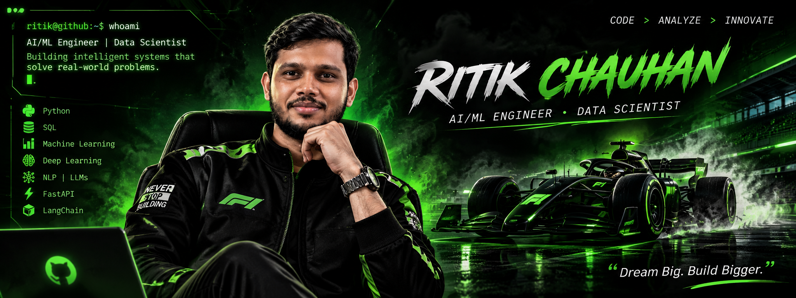

<div align="center">



# RITIK CHAUHAN

### AI/ML ENGINEER  |  DATA SCIENTIST

**Build intelligent systems that solve real-world problems.**

[](https://git.io/typing-svg)

[](https://github.com/ritikchauhan2068)
[](https://www.linkedin.com/in/ritik-chauhan-06b279211/)
[](https://www.kaggle.com/ritikchauhan2068)


</div>

---

## `01 / ABOUT ME`

<table>
<tr>
<td width="65%" valign="middle">

```bash
┌──(ritik㉿github)-[~]
└─$ whoami

AI/ML Engineer
Data Scientist

└─$ mission

Building intelligent systems
that solve real-world problems.

└─$ status

Learning | Building | Improving
```

I enjoy turning raw data into meaningful insights and transforming ideas into practical AI-powered applications.

- Exploring Machine Learning and Deep Learning.
- Building recommendation systems and intelligent automation.
- Interested in NLP, LLMs and AI applications.
- Currently exploring MCP and modern AI tools.

</td>
<td width="35%" align="center" valign="middle">


**FULL THROTTLE.**

</td>
</tr>
</table>

## `02 / TECH ARSENAL`

<div align="center">

**PROGRAMMING & DATA**


**AI & MACHINE LEARNING**


**BACKEND & TOOLS**


</div>

## `03 / PROJECTS`

<table>
<tr>
<td width="50%" valign="top">

### 01. OCR FOR BUSINESS

**Automating business order intake.**

- Extracts order information from images, PDFs and messages.
- Uses OCR and structured extraction.
- Automates Google Sheets entry.

`Python` `Tesseract OCR` `LLMs` `Google Sheets API`

[↗ VIEW SOURCE CODE](https://github.com/ritikchauhan2068/OCR-For-Business)

</td>
<td width="50%" valign="top">

### 02. FLAT RECOMMENDATION SYSTEM

**Property recommendation application.**

- Helps users discover relevant properties.
- Uses recommendation techniques.

`Python` `Machine Learning` `Streamlit`

[↗ VIEW SOURCE CODE](https://github.com/ritikchauhan2068/Flat-recommdation-system)

</td>
</tr>

<tr>
<td width="50%" valign="top">

### 03. MACHINE LEARNING MATHS WITH PYTHON CODE 

**Maths behind the every algo of machine learning .**

This repository documents my daily exploration of the mathematical intuition behind Machine Learning algorithms and their implementation in Python.

`Python` 

[↗ VIEW SOURCE CODE](https://github.com/ritikchauhan2068/Machine_Learning_Algorithm_Maths_Python)

</td>
<td width="50%" valign="top">

### 04. WEB SUMMARIZER

**AI-powered web content summarization.**

- Extracts webpage content.
- Summarizes information using language models.

`Python` `LangChain` `LLMs`

[↗ VIEW SOURCE CODE](https://github.com/ritikchauhan2068/Web_Summarizer)

</td>
</tr>

<tr>
<td width="50%" valign="top">

### 05. VEHICLE INSURANCE MLOPS

**End-to-end ML project.**

- Vehicle insurance prediction use case.
- Machine learning workflow.

`Python` `Machine Learning` `MLOps`

[↗ VIEW SOURCE CODE](https://github.com/ritikchauhan2068/Vehicle-Insurance-Domain)

</td>
<td width="50%" valign="top">

### 06. MORE PROJECTS

Explore my other data science, machine learning and development experiments.

[↗ ALL REPOSITORIES](https://github.com/ritikchauhan2068?tab=repositories)

</td>
</tr>
</table>

## `04 / CURRENTLY IN THE LAB`

```text
[ IN PROGRESS ]

├── Model Context Protocol (MCP)
├── Modern AI developer tools
├── LLM applications
├── AI Agents
└── Machine Learning & Deep Learning
```

## `05 / GITHUB ANALYTICS`

<div align="center">


</div>

## `06 / CONTRIBUTION TRACKER`

<div align="center">


</div>

## `07 / FOCUS MODE`

<div align="center">

### ♫ SOFT PIANO · DEEP FOCUS

[](https://www.youtube.com/results?search_query=soft+piano+ambient+coding+music)

*Click to listen. Let the ideas flow.*

</div>

## `08 / CONNECT`

<div align="center">

[](https://www.linkedin.com/in/ritik-chauhan-06b279211/)
[](https://www.kaggle.com/ritikchauhan2068)
[](https://voluble-panda-3a9ee0.netlify.app/)
[](https://github.com/ritikchauhan2068)

**Thanks for visiting my profile. Let's build something intelligent.**

</div>
